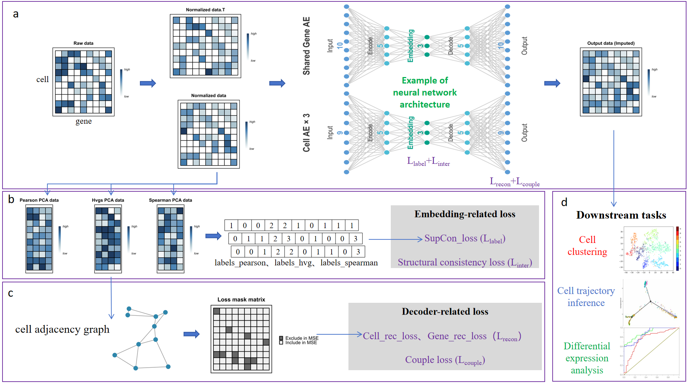

# MaDuAE
## Introduction
A three-tower dual-path autoencoder (MaDuAE) for scRNA-seq data imputation

## Required configuration
Our testing was completed in the recommended environment (requirements.txt). Please make sure to precisely adjust the package versions to match your GPU/CPU machine versions.
## Installation
git clone https://github.com/6w6u/MaDuAE
cd MaDuAE
## Usage example
###
In most cases, it is sufficient to use it directly under the default parameters. For cell trajectory inference tasks, we recommend reducing the concest_ceight and inter_tower_Simweighted values to 0.01.
### Specific arguments:
hidden_dim (int):   Autoencoder hidden dimension, default 32 
num_epochs (int):   Maximum training epochs, default 300 
learning_rate (float):   Learning rate, default 1e-3 
weight_decay (float):   Weight decay, default 3e-4 
couple_weight (float):   Path-coupling loss weight, default 1.0 
consist_weight (float or list):   Supervised Contrastive loss weight, default 0.1. Can be a single value (same for all towers) or a list of length 3 (different per tower) 
inter_tower_sim_weight (float):   Inter-tower similarity consistency weight, default 0.1 
patience (int):   Early stopping patience, default 15 
batch_size (int):   Training batch size, default 1024 
train_ratio (float):   Training set ratio, default 0.9 
n_neighbors_list (list):   Neighbor count list for Leiden clustering, default [15, 20] 
resolution_list (list):   Resolution list for Leiden clustering, default [0.3, 0.4, ..., 1.2] 
min_cells (int):   Minimum cells for gene filtering, default 3 
n_pca_neighbors (int):   Number of neighbors for PCA neighbor search, default 101, including self 
k_neighbors (int):   Final number of neighbors to keep, default 11, including self 
device (str):   Computing device, default 'cuda' (auto-detected) 
verbose (bool):   Whether to print training logs, default True 
random_state (int):   Random seed, default 0
### Running demo
The Clustering Example and the Rare Cell Recognition Example each provide usage examples for two datasets. For detailed instructions, please refer to the Instruction.txt file in the respective directories.
## Contact
If any questions, you can contact us through the following ways：
Wentao Wu, 244711098@csu.edu.cn

